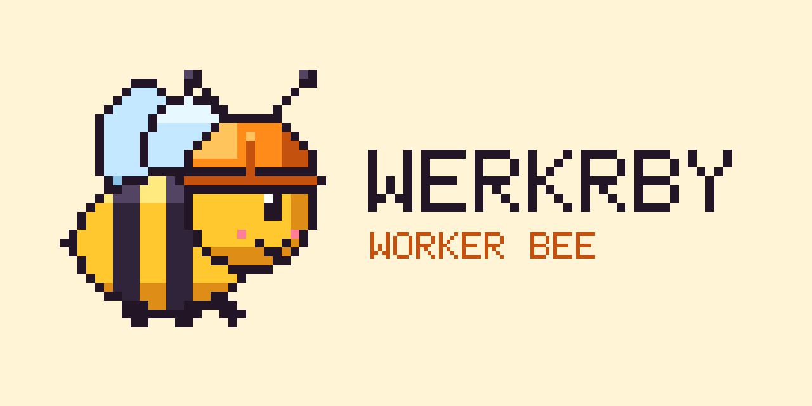

<p align="center">
  
</p>

<h1 align="center">Werkrby</h1>

<p align="center">
  <em>Pronounced "worker bee". One chat in front of a hive of AI coding agents.</em>
</p>

<p align="center">
  <a href="https://github.com/agent0ai/spynel"></a>
  
  
  <a href="LICENSE"></a>
</p>

---

Werkrby is a personal fork of [Spynel](https://github.com/agent0ai/spynel), the classic (non-AI) orchestrator from the Agent Zero team. You talk to one assistant. Werkrby turns that conversation into Markdown tasks and goals, hands them to whichever coding agent fits (Claude Code, Codex, Kimi, OpenCode, Gemini, agy, Hermes and others), runs review, and keeps the evidence on disk.

It isn't a competing product. It's one homelab's tuned build: a particular harness mix, Herdr panes, and a few hard-won rules about attempts, stops and review. Generally useful fixes go upstream.

## How it works

```
 you ──► one chat ──► Werkrby ──► worker bees
          (TUI, Telegram,   │        claude-code · codex · kimi · opencode
           web front desk)  │        gemini · agy · hermes · pi · …
                            ▼
             .spynel/tasks/{todo,working,review,done,…}/*.md
             goals · leases · evidence · history
```

- **The hive is plain files.** Tasks and goals are Markdown with front matter. Every phase (claim, implement, review, done) is a file move you can read, diff and grep.
- **The orchestrator is deterministic.** Werkrby supplies coordination; the harnesses supply the intelligence. Better agents make the hive better without code changes.
- **Workers live in Herdr panes.** Each task gets an isolated pane, named so you can see who is working on what, and closed when the turn really ends.

## What this fork adds

| Area | Change |
| --- | --- |
| Routing | Per-task agent routing, a per-seat roster, and escalation to a stronger seat after N failed attempts |
| Review | Multi-agent review pipeline; the reviewer comes from a different model family than the implementer |
| Queue | Goal work claims first; queued documents are claimed oldest-first; goal work pauses standalone work for a slot instead of holding it off the board |
| Hand-off | Opt-in acceptance gate: a registered check must pass before a task can leave implementation |
| Control | An operator Stop parks the task (it's not mistaken for a service restart); job kill and interrupt never queue behind the turn they stop |
| Resilience | Service restarts don't spend attempts; quota parks wake at the provider's real reset time |
| Herdr | Warm and dynamic agent panes, isolated worker workspaces, idle-stability checks before tab close, undelivered-prompt guard |
| Channels | Web front desk with task steer, decide and review controls alongside the TUI and Telegram |

The full delta list is in [docs/werkrby-fork.md](docs/werkrby-fork.md).

## Quick start

There are no published Werkrby releases; build from source (Go 1.25, CGO on):

```sh
git clone https://github.com/dajoey/Werkrby.git
cd Werkrby
./scripts/dev.sh build          # .tmp-bin/werkrby (+ spyjo and spynel aliases)
./scripts/install-dev.sh        # installs werkrby to ~/.local/bin
```

Then, from a workspace directory (never inside the checkout):

```sh
werkrby init --dir ~/hive       # create a workspace
cd ~/hive && werkrby            # open the TUI
werkrby docs                    # offline reference for agents and humans
```

The old `spyjo` and `spynel` commands still work as aliases.

## Documentation

- Fork notes and setup deltas: [docs/werkrby-fork.md](docs/werkrby-fork.md)
- Documentation index: [docs/README.md](docs/README.md)
- Product docs (configuration, harnesses, tasks and goals, architecture, security) stay canonical upstream: [agent0ai/spynel/docs](https://github.com/agent0ai/spynel/tree/main/docs)

## Credits

Werkrby builds on [Spynel](https://github.com/agent0ai/spynel) by the Agent Zero team, under the MIT license. Upstream's docs, protocol and product direction are theirs; this fork's changes are maintained by [@dajoey](https://github.com/dajoey). The pixel-art bee is drawn by [`docs/assets/source/make_icon.py`](docs/assets/source/make_icon.py).
